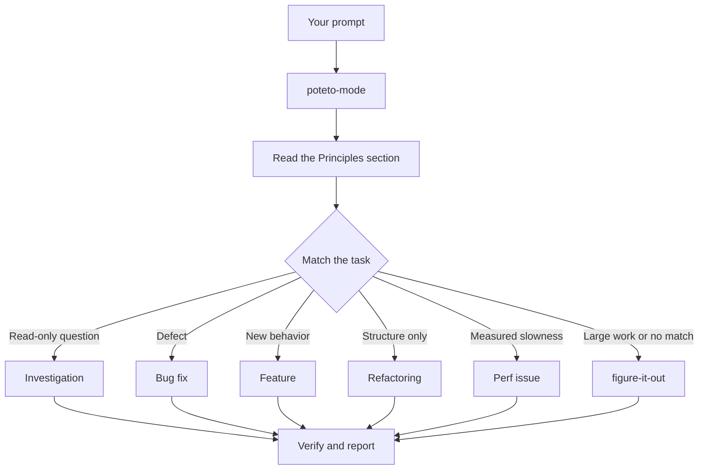

# 通过 `/poteto-mode` 分派工作

`/poteto-mode` 是入口。你给它一个目标，它会匹配二十三个 playbook 之一，把该 playbook 的步骤复制到待办列表中，并在步骤需要时调用其他 skill。本页介绍一条好的提示是什么样子，以及你实际上需要多少内容。


## 你的提示会发生什么



上图展示的是常见路由。此外还有用于爬山式优化指标的 playbook、诊断运行时症状和捕获的 trace 的 playbook、原型、视觉对齐、编写和评估 skill、自主运行、开 PR、推进 PR 或 stack 直至可合并、交付已验证的 stack、在自动驾驶模式下运行 PR 队列或 stack、编排项目级程序、会话接续、安全暂停、多阶段计划，以及 worktree 清理。完整列表见 [playbook 目录](../../skills/poteto-mode/playbooks/)。

## 说出目标，而不是流程仪式

你不需要写 spec。说明什么地方不对，或者你想要什么，再加上你已经知道、能为 agent 省下时间的任何信息：

```text
/poteto-mode users get two notifications after a retry. repro first, then fix and verify.
```

这是一个 Bug fix 提示。"repro first" 是一个真实的约束，不是客套话，playbook 会遵守它。看着待办列表被 Bug fix 的步骤填满。被跳过的步骤会以 `skip: <reason>` 的形式保持可见。

## 提示里应该写什么

一条有用的提示最多包含五件事，每件都能用一句话说清：

- **目标。** 说明什么地方不对，或者你想要什么。
- **完成检查。** 它必须能判定通过或失败。"Make it better" 和 "work on it for an hour" 都不是检查。
- **你想看到的证明。** 要求真实的命令输出、流程的视频、存储的值，或者前后对比的数字。
- **你已经知道的情况。** 一个症状、一个复现步骤、一行日志或一个链接，都能为 agent 省去搜索。
- **真实的约束。** "repro first"、"don't change any code yet"、"zero behavior change" 和 "let me review before proceeding" 每一条都会改变 agent 的行为。

这是一条包含全部五项内容的提示：

```text
/poteto-mode the csv export drops its last row since yesterday's deploy. failing job id is 4812. repro first, then fix. done means the 60k-row fixture exports every row. show me the row counts before and after.
```

有两样东西最好不要写进去：

- **具体怎么做。** 说明要达成什么，给 agent 留出空间去找到比你想到的更好的路径。关于 skill 列表也是同理，见下面的陷阱。
- **你最初的原因猜测。** 陈述的猜测会把搜索范围缩小到你指向的地方。在你分享自己的直觉之前，先让 agent 重新表述问题。

对于嘈杂的报告，例如很长的讨论串或模糊的 bug，要把重新表述作为第一步：

```text
/poteto-mode read this thread. restate the underlying issue in your own words, in plain english. don't change any code yet.
```

重新表述中会暴露误解，而那时还没有任何代码。在这里纠正它，只需要一条消息，而不是一次错误的修复。如果只需要重新表述，不需要 playbook，可以运行 [`/in-your-own-words`](../../skills/in-your-own-words/SKILL.md)。它会复述 agent 认为你的目标是什么、你想解决什么问题。

当你不确定某个任务的方向是否正确时，把 [`/sharpen`](../../skills/sharpen/SKILL.md) 放在它前面：

```text
/sharpen write a migration guide for the v2 config format.
```

在开始之前，agent 会先问：一位顶尖专家会如何完成这项任务、你真正想要什么，以及这个请求是否过度或不足地说明了。它会删除那些对目标没有帮助的约束，同样乐于添加那些有帮助的约束，把你的选择保持开放，并保留一项外部检查来确认结果正确。然后它才开始做事。

## 短句跟进

当对话中已经带有上下文时，提示可以缩得几乎为零。以下这些都足够：

```text
/poteto-mode do it
```

```text
continue
```

```text
keep going until done
```

短句之所以有效，是因为 playbook 承载了结构。[设置 pstack](./01-setup.md#run-your-first-task) 展示了如何启动它。你的话传递意图，skill 负责严谨性。

## 用 "new task" 切换任务

一个很长的聊天会累积上一个任务的上下文。换主题时，请明确说出：

```text
/poteto-mode new task. figure out why the cache entry survives logout. don't change any code yet.
```

"new task" 会告诉 `/poteto-mode` 重新匹配，而不是延续之前的 playbook。"don't change any code yet" 把这次任务固定为 Investigation。如果没有这两个短语，处于 Feature 中间的模式往往会把你的问题当作下一个功能步骤。

## 为并行工作分配独立的 worktree

当工作必须留在本地时，预先要求一个 worktree：

```text
/poteto-mode new task. branch off <base> in a fresh worktree, then port the parser change there.
```

每个任务都在自己的分支和 worktree 中，因此不会有 agent 踩坏别人的文件。Worktree 会占用磁盘和机器资源，所以笔记本一次只能运行少量 worktree。[开 PR 的 playbook](../../skills/poteto-mode/playbooks/opening-a-pr.md) 已经能在 worktree 中为代码改动工作，因此通常只有在特定的基线或位置很重要时，你才需要这样说。

Worktree 会不断累积。磁盘紧张时，可以询问：

```text
/poteto-mode what's eating my disk? prune the worktrees that are safe to prune.
```

[Worktree 清理 playbook](../../skills/poteto-mode/playbooks/worktree-cleanup.md) 会按合并状态、未提交的工作，以及哪些聊天仍在使用它，对每个 worktree 进行分类。它只删除证据已经允许删除的内容，并且对于仍含有未提交工作的 worktree，会暂停等待你的决定。

## 让它继续运行

当你要离开时，说明完成的标准，然后启动：

```text
/poteto-mode im stepping away. keep going until the migration check reports zero old callers. log your decisions.
```

你之后要审查的工作会通过 [`/figure-it-out`](../../skills/figure-it-out/SKILL.md) 路由，它会设计本次运行的各个阶段，并保留一份 [`/show-me-your-work`](../../skills/show-me-your-work/SKILL.md) 决策日志。[在睡觉时运行工作](./07-overnight.md) 涵盖完整的过夜约定。

**陷阱:** 不要在提示中列举 skill（例如 "use /how, then /architect, then /arena..."）。playbook 已经排好了它们的顺序，而手写的顺序通常会重新排列或丢掉 playbook 原本会保留的步骤。只有当你想覆盖某个特定选择时，才点名某个 skill。

阅读 [`poteto-mode`](../../skills/poteto-mode/SKILL.md) 本身，以了解完整的路由规则。

下一步: [理解代码](./03-understand.md)。
