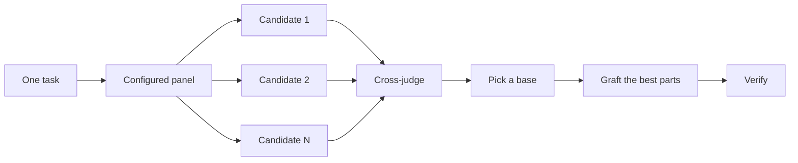

# 写代码前先做设计

一次对难题的设计尝试，往往会锁定模型最先想到的那个形状。`/architect` 在实现之前先确定类型和边界。`/arena` 对同一份需求跑多次尝试，再合并其中最好的部分。`/interrogate` 让其他模型尝试攻破结果。当任务的重点是覆盖面而不是设计综合时，`/swarm` 会把任务分片或赛跑，再汇总结果。

最常见的两个设计错误，是直接采用 agent 的第一个设计，或者去打磨一份没有任何代码验证过的计划。本页针对这两点。你要通过代码来做规划。原型用来回答悬而未决的问题，README 或教程用来确定目标，书面计划放在最后。


## 用 `/architect` 确定形状

```text
/architect design the import pipeline before writing any code. i care most about how callers use it.
```

[`/architect`](../../skills/architect/SKILL.md) 先自行建立上下文，对设计涉及的代码运行 `/how`，如果它改变了所有权或分层，则运行 `/why`。接着它运行 `/arena`，生成相互竞争的设计草图。每份草图都先写调用方的用法，然后是类型、签名和模块图。

默认情况下，它会从综合后的设计直接进入实现。如果你想先看设计，请明确说明：

```text
/architect with checkpoint. stop and show me before implementing.
```

代码开始编写之后，设计也不是一成不变的。如果实现过程中，在互不相关的地方出现了同样的变通做法，或者类型只有借助 `any` 或强制类型转换才能通过编译，`/architect` 会把这视为设计有误的证据。它会丢弃草图并重新开始，而不是在上面打补丁。

## 用 `/arena` 分发多次尝试

```text
/arena take my prompt to the arena verbatim. i want to compare their proposals with yours.
```

[`/arena`](../../skills/arena/SKILL.md) 是底层的通用工具。N 个子 agent 并行地对同一份设计或代码需求进行尝试，每个子 agent 写入自己的 worktree 或目录。一个只读的评审者会按照评分标准给每个候选方案打分，如果你的配置允许，评审者会使用不同的模型系列。协调者会通读每个候选方案，选定一个基础版本，从落选方案中嫁接最好的想法，然后验证结果。



参与的评审团来自你的 [`/setup-pstack`](../../skills/setup-pstack/SKILL.md) 配置，你也可以按任务逐个调整。当决策很重要时，多要几个候选方案；当决策无关紧要时，少要几个：

```text
/arena this, 5 candidates. the cache key format is expensive to change later.
```

## 用 `/swarm` 覆盖分片和赛跑

```text
/swarm check every package under packages/ against its check.sh. one worker per package. one report.
```

[`/swarm`](../../skills/swarm/SKILL.md) 会把 N 个 worker 分派到独立的分片、覆盖矩阵、gauntlet 通道、探索分区，或者预先声明好的赛跑分支上。每个 worker 都有自己的范围和检查项，然后报告 `PASS`、`ISSUES` 或 `BLOCKED`。父级会等待所有 worker 完成，并返回一份简洁的报告，列出其中的缺口或中途退出的 worker。

当并行能换来覆盖面，或者能让相互独立的检查进行赛跑时，就用它。`/arena` 会给每个 worker 同样的设计或代码需求，然后选定基础版本并嫁接最好的部分。`/swarm` 负责覆盖分片，或者按事先声明的选择规则进行赛跑。它不使用基础版本选择和嫁接这一套流程。

## 用 `/interrogate` 攻破它

```text
/interrogate the whole branch, but skeptically. no nitpicks unless it's an actual bug or regression.
```

[`/interrogate`](../../skills/interrogate/SKILL.md) 把同一份 diff、意图和评分标准发送给不同模型系列的评审者。模型的多样性正是关键所在。不同模型有不同的盲区，因此两个模型各自独立提出的同一个问题，置信度很高。主导者会把所有内容归入 `Act on`、`Consider`、`Noted` 和 `Dismissed` 四类，并为每一条驳回给出理由，而且不会自动应用任何改动。

也要阅读那些被驳回的条目。主导者是一位务实的资深工程师，不是神谕，你可以推翻它的判断。

## 用原型代替辩论

永远不要直接采用第一个设计。多要几个方案，然后基于你能亲眼看到的证据来挑选：

```text
/poteto-mode prototype a few options for the new dropdown menu. take screenshots or videos for me to compare.
```

[原型 playbook](../../skills/poteto-mode/playbooks/prototype.md) 会在临时目录中搭建一次性草图，把各个变体放在同一个切换器后面，逐一操作，并截取截图或记录耗时。它不仅适用于 UI，也适用于行为和算法。原型就是用代码来做规划。它们让 agent 通过运行东西来回答自己的悬而未决的问题，而不是来问你，同时也为你没想到的选项留出空间。

同样的思路也可以扩展到真正的设计上。把 `/architect` 和原型搭配使用，并保留一道评审关卡：

```text
/poteto-mode we need rate limiting for external webhooks. /architect it first, and answer open questions with prototypes. let me review before proceeding.
```

不要把评审资源浪费在抽象的计划上。`/interrogate` 应该用在 diff 上。如果对一份背后没有任何代码的计划进行对抗式评审，评审者会凭空编造理论上的风险和边缘情况，而这些情况永远不会发生。让原型去解决问题，然后评审已经构建出来的东西。

## 对共享代码先写 README

对于其他代码会使用的包或 API，先从用户会阅读的那份文档开始：

```text
/poteto-mode write a tutorial for how i would use the new config package first. then /teach me why it beats the current one.
```

先写教程，会迫使你站在调用方的角度。你向一个假想的用户描述 API，然后从接口反推实现。这份文档还会成为 agent 检查自己工作的具体目标。当文档本身很重要时，点名 [`/technical-writing`](../../skills/technical-writing/SKILL.md)，这样教程就不会在写的过程中滑向参考手册和原理解释的混合体。

## 设计定下来之后再做计划

pstack 刻意没有规划类的 skill。当你确实需要一份书面计划时，请在设计定下来之后再提出：

```text
/poteto-mode turn this design into a plan. small verifiable PRs, each with its own verification steps.
```

[多阶段计划 playbook](../../skills/poteto-mode/playbooks/multi-phase-plan.md) 会先用原型解决剩余的悬而未决的问题，然后为每个 PR 写一个小节，每节都以证明该改动有效的内容结尾。仅仅通过测试套件并不算作证明。计划本身就是交付物。这个 playbook 不负责实现计划，但会指明接下来应由哪个执行 playbook 来执行它。

对于迁移任务，请在提示词中写明验收标准：

```text
/poteto-mode plan the migration of our ui library to the new styling system. small verifiable PRs, each with visual regression checks. the result must match the original exactly, bugs included.
```

"bugs included"（包括 bug）可以防止迁移过程中悄悄修掉某些问题，否则新旧输出就无法进行比较。对于跨越多天的项目，你可以把计划提交到仓库里保留一段时间，让其他 agent 看到正在进行中的工作。工作完成后再删除它。

## 一项任务值得多少设计工作？

你可能会想，是不是每个改动都需要这些。不，大多数改动都不需要。下面是一个粗略的梯度：

- 一个小而完整、但你拿不准的改动，只需要 `/interrogate`。
- 跨越函数边界或改变所有权的改动，值得使用 `/architect`，它会带上 `/arena`。
- 独立的决策，例如命名、格式或算法，如果独立尝试会有帮助，直接用 `/arena`。
- 覆盖矩阵、一组并行检查，或者声明了分支的赛跑，用 `/swarm`。
- 一个你可以通过运行东西来回答的悬而未决的问题，例如布局、耗时或某种做法，用原型，而不是辩论。
- 一个难以逆转、有争议的设计，先用 `/architect`，发布之前再用 `/interrogate`。
- 跨越多个 PR 的工作，在设计定下来之后再写计划。

`/poteto-mode` 已经应用了这个梯度。跨越边界的工作会自动触发 `/architect`，所以你主要是在想要比默认情况更多或更少审查时，才直接调用这些工具。

下一步：[构建并清理改动](./05-build-and-clean.md)。
