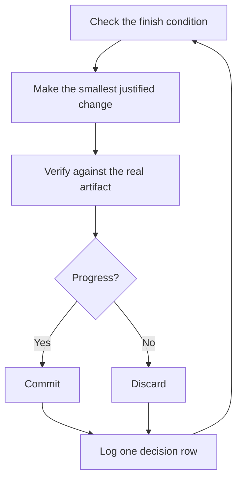

# 你睡觉时让工作继续运行

这是前面所有内容的回报。一个你信得过、能自己验证工作的 agent，才能放心交给它一个难任务，让你不用盯着。让这件事安全的不是希望，而是一个可检查的完成条件、一个隔离的 worktree，以及一份你第二天早上可以审计的决策日志。


## 先赢得信任，再启动循环

你不信任的循环只会更快地产出未经检查的工作，而且每一轮迭代都会让烂摊子越滚越大。在你让它离开你的视线运行之前，先确认它已经赢得了这份信任：

- 你亲手做过一次这个任务，或者亲眼看着 agent 做过，所以你知道什么样的结果才是好的。
- agent 拥有你自己会用的工具和信号：验证用的 skill、profiler、日志。
- 每个阶段都能证明自己的工作，并且在工作达不到标准时能叫停整条流水线。
- 你读过几份 transcript，并把反复出现的失败变成了工具、skill 或检查项。

只有当这四条都成立时，才让循环自主运行。在那之前，请一边盯着一边运行。

## 过夜约定

一份好的交接包含目标、完成条件、权限，以及一个出口。它不需要很长：

```text
/poteto-mode im going to bed. migrate every caller to the new parser in a fresh worktree off <base>.
done means zero old callers, all parser fixtures pass, old api deleted.
keep a decision log. don't ask me before committing.
/loop until done. alarm yourself in N hours to detect stucks, stop and write up why.
```

逐行看看每一句给你带来了什么：

- "im going to bed" 是一次会话级的覆盖。agent 会停止提问，继续推进。
- "done means..." 把目标变成了每一轮迭代都能运行的检查项。
- "fresh worktree off `<base>`" 让这次运行不会和你打开的其他东西互相冲突。
- "don't ask me before committing" 提前回答了 agent 否则会卡住等待的权限问题。
- `/loop` 是运行环境内置的唤醒机制（Cursor 的 `/loop`、Claude Code 的 `loop` skill），不是 pstack 的 skill。[自主运行 playbook](../../../skills/poteto-mode/playbooks/autonomous-run.md) 用它在事件发生或心跳到达时重新检查完成条件。
- 出口让它在遇到真正的死胡同时停下来，并写明原因。这比让它花八个小时对目标进行创造性的重新解读要好得多。

因为你会在离开之后审阅这些工作，所以 `/poteto-mode` 会把它交给 [`/figure-it-out`](../../../skills/figure-it-out/SKILL.md) 处理。这个 skill 会在动任何代码之前设计运行的各个阶段，并接入决策日志。

如果你想主动停止一次运行，就告诉 agent 暂停，或者告诉它你即将离线，或者要重启 Cursor。[安全暂停 playbook](../../../skills/poteto-mode/playbooks/pause-safely.md) 会完成或回退当前步骤，提交一个进行中的工作检查点，并写下一份恢复说明。新开的聊天会通过会话接续 playbook 从这份说明接着做。说 "keep going" 永远不会触发暂停。

## 整夜循环在做什么



每一轮迭代都是：一次改动、一次检查、一行日志。没有帮助的改动会被丢弃，而不是留着继续生效。陷入停滞意味着换方向，而不是停下来；完成条件也绝不会悄悄放宽来宣布胜利。

## 早上的审计

[`/show-me-your-work`](../../../skills/show-me-your-work/SKILL.md) 让这次运行变得可以审阅。每一行记录时间、阶段、决策、理由、证据指针和结果，保存在 `decisions.tsv` 里（当多次运行共用一个目录时，则是 `.audit/<task-slug>.tsv`）。它默认只保存在本地。当工作足够复杂，审阅者需要这份轨迹才能信任结果时，再把它提交进版本库。

回到电脑前，用审阅的形式让它汇报这次运行：

```text
/show-me-your-work catch me up on what you did last night
```

在这个 skill 交回摘要之前，它会派出一个来自不同模型的审阅者，去阅读轨迹和 transcript。回复的最后会有一节 Attention，列出值得你重点看的内容。先读这一节，再去看它指向的日志行。你审计的是决策，而不是把整夜的内容重读一遍。

如果你想快速查看状态而不是做审计，就在运行这次工作的那个聊天里执行 [`/ketchup`](../../../skills/ketchup/SKILL.md)。它只读取，会用直白的话告诉你自上一条消息以来发生了什么变化，并附上工作产生的截图和小图表。然后它会列出每一个等待你处理的决定，例如合并、审批，或在多个选项之间做选择，并给出它的选择、证据和风险，让你仅凭这份回复就能做决定。

## 当夜里是一个队列而不是一个任务

上面的约定驱动的是一个任务达到一个完成条件。有些夜晚会有更多内容：一队相互独立的改动，或者整个程序。有三个 playbook 能把同样的信任扩展到这些场景。

[Autopilot-full](../../../skills/poteto-mode/playbooks/autopilot-full.md) 会把一队相互独立的 PR 一直推进到合并。每个 PR 由一个 owner agent 负责，从构建一直带到合并，而任何 owner 都不能仅凭自己的结论合并。一群全新的 verifier 会检查 owner 已准备好的代码头。之后的 rebase 或小修复只会派出一个全新的 verifier，只有新的行为或大幅的新 diff 才会再次启动完整的 verifier 群。只有针对即将合并的那个补丁给出的干净结论，才能授权合并：

```text
/poteto-mode full autopilot on this queue. each item is independent. i want them merged by morning.
```

[Autopilot-stack](../../../skills/poteto-mode/playbooks/autopilot-stack.md) 运行的是同样的 owner 循环，但它不发布任何东西。你醒来时会得到一条线性的基础分支 stack，每个环节都附有 verifier 的结论，由你自己审阅并决定合入。当改动之间相互耦合，或者你希望在任何内容合并之前亲自过目时，就选 Autopilot-stack 而不是 Autopilot-full：

```text
/poteto-mode autopilot these five changes but stack them, don't ship. i'll land the stack in the morning.
```

[Orchestrate](../../../skills/poteto-mode/playbooks/orchestrate.md) 用于那种会超出任何单个 agent 生命周期的程序：跨越多天、包含许多堆叠的 PR，由一个常设协调者聊天统一管理一批 subagent。协调者负责编写 brief，收集其 subagent 完成的内容，让最靠前的未合并 PR 保持绿色，并且自己从不写代码。它是刻意设计得很重的机制。如果一个 agent 就能在一个会话里完成工作，这个 playbook 本身会把你带回上面的过夜约定：

```text
/poteto-mode orchestrate the store migration. own it until every package is converted and merged. i'll check in twice a day.
```

## 并行运行多项工作

为每项工作配一个协调者对话。协调者不写代码，它指挥 subagent，每个 subagent 在自己的本地 git worktree 和分支里工作。这正是 Orchestrate playbook 所预期的形态。向协调者发送提示时以 `/poteto-mode` 开头，它派生出的 subagent 会遵循各个 playbook。

以下几个习惯会有所帮助：

- 为每一块工作单独开一个协调者对话，比如一个功能、一次迁移、一轮性能优化或一次技术债清理。多个对话可以并排运行。
- 在 PR 合并之前为其配置一个验证群，并让 Autopilot-stack 或 Autopilot-full 来负责推进队列。
- 请协调者给出一份以数据为依据的计划，并让它先用原型回答悬而未决的问题，再来问你。

一条提示就可以承载整项工作，从调研一直到执行：

```text
/poteto-mode refactor this repo so its architecture is more agent friendly. use /correct and /architect on past commits and review comments to find the mistakes agents make most here. use /recall for context from past chats. answer open questions with prototypes instead of asking me. come back with a plan backed by real data. once i approve it, run it with autopilot-stack or autopilot-full, and ask me which.
```

## 让循环自行启动

上面的每个循环仍然需要你来启动。定时的或事件驱动的自动化会去掉这一步。软件维护可以拆分成一些很适合这种方式的阶段：分诊一个报告、复现它、修复它、验证修复。有两条规则能让这样的流水线值得信任：

- 每个阶段都可以叫停整条流水线。分诊可以判定该报告是预期行为，复现可以失败、无法复现问题，修复者可以判断改动风险过高。这些结果每一个都有用，因为它们能阻止糟糕的工作流入下一个阶段，而那里的撤销成本更高。
- 每个阶段都会交出证据。复现会附上损坏状态的截图和视频，修复会附上修复前后的证明。这样，人在阅读任何一行代码之前，就能先检查 agent 是否修对了东西。

**常见陷阱：** 时长不是完成条件。"work on this for 4 hours" 没有给 agent 任何可以检查的东西，你醒来时看到的只会是四个小时的忙碌，而不是一个结果。给 `/loop` 一个可以通过或失败的判定条件。

下一步：[用原则名称引导 agent](./08-principles.md)。
